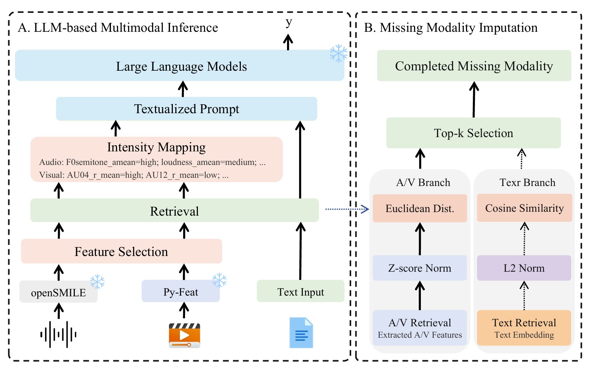

# Retrieval-Guided Feature Verbalization for LLM-Based Multimodal Sentiment Analysis with Missing Modalities

## Introduction
Multimodal sentiment analysis degrades when one or more modalities are missing. Existing MLLM-based approaches assume complete inputs and require additional training to align acoustic and visual information with the language model. The continuous vectors produced by this alignment carry no explicit attribute-level semantics, so the model cannot directly exploit concrete affective cues such as pitch or facial muscle movement.
We propose **Retrieval-Guided Feature Verbalization (RGFV)**, a training-free retrieval-augmented framework for sentiment analysis under missing modalities. RGFV retrieves similar samples from a multimodal bank using the modalities that are available, uses the paired information stored with those samples to approximately compensate for the missing ones, and verbalizes the observed and compensated feature values as text with explicit intensity semantics. A frozen language model then reasons over the combined evidence, so no modality-to-language projection training is required.
## Architecture
The framework consists of four stages:
1. **Feature selection.** Acoustic and visual features that are statistically associated with sentiment are retained, which reduces redundancy in retrieval and prompt construction.
2. **Retrieval.** The available modalities query a multimodal sample bank of annotated samples.
3. **Compensation.** Paired information stored with the retrieved neighbours approximately reconstructs the missing modalities.
4. **Verbalization.** Observed and compensated feature values are rendered as text with explicit intensity levels, and the frozen language model performs inference on the resulting prompt.
Experiments on CMU-MOSI, CMU-MOSEI and CH-SIMS with three language-model backbones show that RGFV raises the average weighted F1 over seven modality-availability settings by 6.34 to 11.26 percentage points, with the largest gains when the textual modality is missing.
